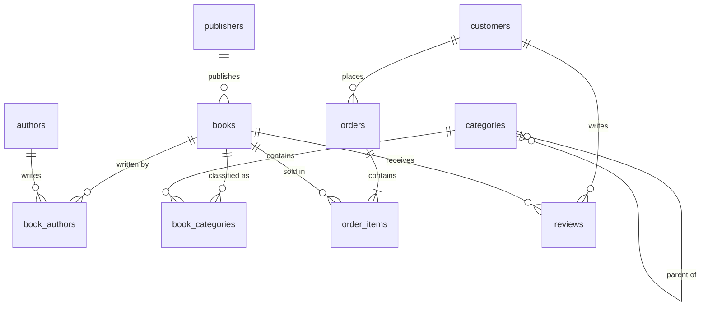

# Online Bookstore — ERD

Student: Dang Minh Tam · ID: 24070614 · Homework 6 · 2026-10-18

Notation: **PK** = primary key, **FK** = foreign key, **UQ** = unique. Crow's Foot: `||` exactly one, `o|` zero or one, `o{` zero or many, `|{` one or many.

## Relationship diagram

```
authors    ||--o{ book_authors    }o--|| books }o--|| publishers
categories ||--o{ book_categories }o--|| books
categories |o--o{ categories                          (parent_category_id: sub-genres)

customers  ||--o{ orders  ||--|{ order_items }o--|| books
customers  ||--o{ reviews }o--|| books
```



## Relationships and cardinality

| Relationship | Cardinality | Implemented by |
|---|---|---|
| Book ↔ Author | M:N | `book_authors (book_id, author_id)` composite PK |
| Book ↔ Category | M:N | `book_categories (book_id, category_id)` composite PK |
| Category → Sub-category | 1:N (self) | `categories.parent_category_id` (nullable) |
| Publisher → Book | 1:N | `books.publisher_id` (NOT NULL) |
| Customer → Order | 1:N | `orders.customer_id` |
| Order ↔ Book | M:N | `order_items (order_id, book_id)` UQ pair |
| Customer → Review | 1:N | `reviews.customer_id` |
| Book → Review | 1:N | `reviews.book_id`; UQ `(book_id, customer_id)` |

## Entities and attributes

**authors**: `author_id` PK · `author_name` · `nationality` · `birth_date` · `biography` · `created_at`

**publishers**: `publisher_id` PK · `publisher_name` UQ · `address` · `website` · `created_at`

**categories**: `category_id` PK · `category_name` UQ · `description` · `parent_category_id` FK → categories

**books**: `book_id` PK · `isbn` UQ · `title` · `publisher_id` FK → publishers · `price` · `stock_quantity` · `publication_date` · `page_count` · `language` · `description` · `created_at`

**book_authors**: `book_id` PK, FK → books · `author_id` PK, FK → authors

**book_categories**: `book_id` PK, FK → books · `category_id` PK, FK → categories

**customers**: `customer_id` PK · `full_name` · `email` UQ · `password_hash` · `phone` · `address` · `created_at`

**orders**: `order_id` PK · `customer_id` FK → customers · `order_date` · `status` · `total_amount` · `shipping_address`

**order_items**: `order_item_id` PK · `order_id` FK → orders · `book_id` FK → books · `quantity` · `unit_price` · `subtotal` (generated) · UQ `(order_id, book_id)`

**reviews**: `review_id` PK · `book_id` FK → books · `customer_id` FK → customers · `rating` (1–5) · `comment` · `review_date` · UQ `(book_id, customer_id)`

## Why it is in 3NF

- **1NF:** a book's authors and categories are rows in junction tables, not lists in one column.
- **2NF:** the only composite keys (`book_authors`, `book_categories`) have no non-key columns.
- **3NF:** `books` stores `publisher_id` only, so the publisher's address is stored once in `publishers`, and the same applies to customers in `orders` and books in `order_items`.
- `order_items.unit_price`, `orders.shipping_address` and `orders.total_amount` are values recorded at purchase time, so they are history and not copies. `subtotal` is a generated column and can never be inconsistent.
